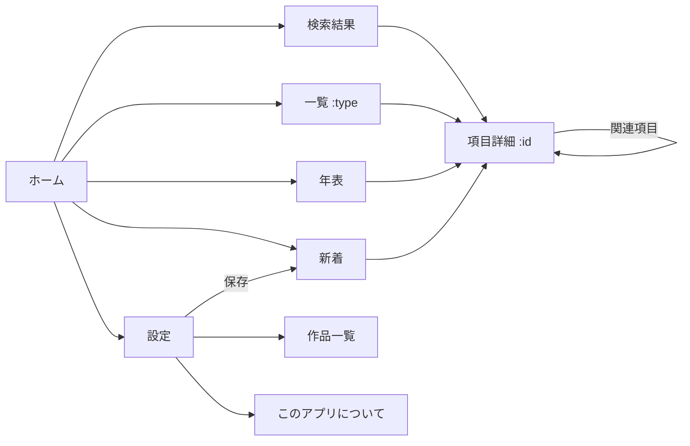

# 03 画面設計・ナビゲーション・デザイン指針

## 1. 画面一覧とルート（HashRouter）

| 画面 | ルート | 役割 |
|---|---|---|
| ホーム | `#/` | 検索窓、種類別の入口、年表への入口、新着、視聴状況のサマリー |
| 検索結果 | `#/search?q=` | 入力に応じて即時絞り込み（ホームの検索窓と共通コンポーネント） |
| 一覧 | `#/list/:type` | 種類別の五十音順一覧。右端に「あかさたな」インデックス |
| 項目詳細 | `#/e/:id` | 本文（記述）、別名、同一人物、登場作品、関連項目、年代 |
| 年表 | `#/timeline` | 時代区分 → 出来事の縦並び。視聴済み作品の帯 |
| 作品一覧 | `#/works` | 視聴済み作品を公開順／時系列順で（F-11） |
| 新着 | `#/whats-new` | 設定変更で新しく読めるようになった項目・記述 |
| 設定 | `#/settings` | 視聴済み作品、表示設定、データ情報、書き出し／取り込み |
| このアプリについて | `#/about` | 非公式・個人利用の明記、出典・ライセンス表記、データ更新履歴 |

下部タブ（常時表示）：**ホーム / 辞典 / 年表 / 設定** の 4 つ。



## 2. ナビゲーションと「戻る」

- ヘッダー左に **戻るボタン**。`history.length` が十分あれば `navigate(-1)`、なければホームへ。
- Android の戻る操作はブラウザ履歴で自然に動く（HashRouter なので pushState が積まれる）。
- iOS のホーム画面起動では OS の戻る操作がないため、**ヘッダーの戻るボタンが必須**。
- **スクロール位置の復元**：項目詳細 → リンク先 → 戻る、で元の位置に戻す（ルートごとに scrollY を保持）。
- **足あと（SHOULD）**：直前に見た項目を最大 5 件、ヘッダー下にチップで表示。タップでその項目へ。
  表示名は現在の watched で解放されている名前（未解放になった項目は非表示）。
- 項目詳細内の本文リンクは同一画面内遷移なので、連続して 10 回飛んでも戻るで 10 回戻れること。
- ディープリンク：`#/e/luke-skywalker` を直接開いたとき、その項目が未解放なら
  「この項目はまだ表示できません（視聴済み作品を設定で追加してください）」を出し、名前は見せない。

## 3. 各画面の要素

### ホーム
- 上部：アプリ名（ユーザー自作ロゴ画像またはテキスト）、検索窓（タップで検索結果へ）
- 視聴状況：「視聴済み 5 作品（データあり 3 作品）」＋設定へのリンク。0 作品なら大きく設定への誘導カード
- 種類別の入口：人物 / 場所 / 組織 / 種族 / 乗り物・兵器 / 道具 / 用語 / 出来事（各 **解放済み件数** を併記）
- 年表への入口カード
- 新着カード（未読の新着があるときだけ）
- 最近見た項目（閲覧履歴から 5 件）

### 一覧
- 種類タブ（横スクロール）、五十音インデックス、各行：表示名＋別名の一部＋NEW バッジ
- 空状態：「まだ表示できる項目がありません」＋設定への導線

### 検索結果
- 入力ごとに即時更新。正規化：NFKC → カタカナをひらがなに → 「・」「＝」「 」「　」を除去 → 英字は小文字
- 対象：解放済み項目の `visibleNames`（text / reading / en）。前方一致を上位、部分一致を下位
- 行：表示名、種類バッジ、ヒットした別名（「別名：ベン・ケノービ」）
- 本文（記述）の全文検索は COULD。実装する場合も `visibleFacts` だけを対象にする

### 項目詳細
1. 種類バッジ（色は種類ごと。勢力色＝青/赤などは **使わない**。所属がネタバレになるため）
2. 見出し：主名称。下に読み・英語名
3. 「別名：…」（解放済みのみ）
4. 「＝ ○○（正体）」：`visibleSameAs` があるとき。相手へのリンク
5. 出来事なら年代表示（§12 of 02）
6. 記述：`summary` を太字で先頭に、以下 `visibleFacts` を順に。箇条書きではなく段落で、各記述の末尾に出典作品の小さなラベル（例：`EP4`）
   - 出典ラベルは **視聴済み作品名の略称** のみ（revealedBy のうち watched に含まれるものだけを表示）
7. 登場作品：`shownWorks` をチップで（公開順）
8. 関連項目：`relatedEntities` ＋ `backlinks`（重複除去、表示名で五十音順）
9. 下部：お気に入り（COULD）、メモ（COULD）

### 年表
- 縦スクロール。時代区分がスティッキーヘッダー（解放済みのみ）
- 左に年の目盛り（BBY/ABY）、右に出来事カード（表示名＋summary の 1 行）
- 視聴済み作品の作中年代を細い帯で左端に表示（作品略称つき）。未視聴作品は帯も略称も出さない
- フィルター：作品チップ（視聴済みのみ）で「その作品で明かされた出来事」に絞る
- 「作品の時系列」ボタン → 作品一覧（時系列順）

### 設定
- **視聴済み作品**：大分類（映画：スカイウォーカー・サーガ / 映画：その他 / 実写ドラマ / アニメ / 子ども向け / 非正史）
  → 中分類（シリーズ）→ 作品。シリーズ行に「全シーズン」チェック
  - 各作品：タイトル、公開年、`note`、パックがなければ「データ準備中」ラベル
  - クイック操作：「映画 9 作」「実写ドラマ全部」「すべて視聴済み」「すべて解除」
  - 保存は即時（チェックした瞬間に反映）。変更後に新着があればトーストで「新着 N 件」→ 新着画面へ
- **表示**：文字サイズ（小/中/大）、「すべて表示（ネタバレ全開放）」トグル（ON 時はヘッダーに警告色の帯を出す）
- **データ**：データバージョン、更新履歴を見る、アプリの更新を確認
- **書き出し／取り込み**（COULD）：設定 JSON をコピー／貼り付け
- **その他**：閲覧履歴を消す、このアプリについて

### 新着
- 「設定を変更して新しく読めるようになったもの」：新規解放された項目のリスト（種類別）、追記された記述がある項目のリスト（件数つき）
- 開いた項目から NEW バッジが消える。「すべて既読にする」ボタン

## 4. デザイン指針

参考：公式サイト（starwars.disney.co.jp）の **雰囲気** に準じる。ただし **ロゴ・画像・フォント・文章は転用しない**。
真似るのは「黒を基調にした宇宙の空気感と、見出しの力強さ、カード型の整理」だけ。

### デザイントークン（`src/styles/tokens.css`）
```css
:root {
  --bg: #0a0a0f;            /* ほぼ黒。星空の下地 */
  --surface: #15161d;       /* カード */
  --surface-2: #1f2029;     /* 浮いたカード・入力欄 */
  --border: #2a2b36;
  --text: #f3f3f5;
  --text-sub: #a0a3b1;
  --accent: #ffd54a;        /* 黄。見出しの下線・主要ボタン・選択状態 */
  --accent-ink: #1a1400;    /* 黄ボタン上の文字 */
  --link: #8fd0ff;          /* 本文リンク。下線つき */
  --danger: #ff6b6b;        /* 「すべて表示」警告帯など */
  --new: #7ee787;           /* NEW バッジ */
  /* 種類バッジ（彩度低め。勢力色ではない） */
  --type-character: #6ea8fe; --type-place: #8bd17c; --type-organization: #c8a2ff;
  --type-species: #ffb86b;   --type-vehicle: #7fd4d4; --type-item: #f0a6c8;
  --type-concept: #d6c38a;   --type-event: #ff9f68;
  --radius: 14px;
  --tap: 44px;
}
```

### タイポグラフィ
- 本文：**OS 標準の日本語ゴシック**（Android は Noto Sans JP、iOS はヒラギノ角ゴシック）、16px / 行間 1.7
  - Web フォントは使わない（外部読み込みゼロ）。self-host も見送った。
    Noto Sans JP は日本語の全サブセットで約 5.8MB あり、オフライン用に事前キャッシュすると
    配信量が現在の約 6 倍になるため。見た目の差は端末上ではごくわずか
- 見出し：同フォントの 700、やや広い字間（`letter-spacing: 0.04em`）。英字の小見出し（EP4 などの略称）は等幅寄りのサンセリフで小さく
- 黄色の細い下線（2px）を見出しの左 or 下にアクセントとして入れる
- スター・ウォーズのロゴ風フォント（いわゆる Star Jedi 系）は使わない

### 背景と質感
- 背景は CSS だけで作る控えめな星空（`radial-gradient` を数個重ねる。画像は使わない。アニメーションはしない）
- カードは `--surface` に 1px の `--border`、角丸 14px、影は最小限
- 画面遷移のアニメーションは短く（150ms 以下）か無し。戻る操作の軽快さを優先

### レイアウト
- モバイル優先。最大幅 640px で中央寄せ（PC でも破綻しない）
- 下部タブ 4 つ（高さ 56px ＋ セーフエリア）。ヘッダーは 48px、戻る・タイトル・（右に検索）
- リスト行は 56px 以上。タップ領域 44px 以上
- 本文リンクは色＋下線＋タップで軽いハイライト。リンクだらけでも読めるよう、同じ項目へのリンクは 1 段落に 1 回まで（データ執筆側のルール、05 参照）

### 空状態・エラー
- 未設定：「まず視聴済みの作品を選んでください」＋ボタン
- 検索 0 件：「見つかりません。未視聴作品の項目は表示されません」
- 未解放のディープリンク：§2 の文言。名前は出さない

### アクセシビリティ
- 文字サイズ設定（小 14 / 中 16 / 大 18px を基準に全体をスケール）
- コントラスト比 4.5:1 以上（黄色文字は黒背景でのみ使う。黄色の上は `--accent-ink`）
- フォーカスリング可視、ボタンに aria-label、戻るボタンに「戻る」のテキスト

## 5. アイコン仕様（ユーザーが自作する）

| ファイル | サイズ | 用途 | 注意 |
|---|---|---|---|
| `public/icons/icon-512.png` | 512×512 | Android / manifest（purpose: any） | 余白は自由。背景は不透明推奨 |
| `public/icons/icon-512-maskable.png` | 512×512 | Android の形状マスク（purpose: maskable） | **中央の直径 80%（約 410px）の円の中に主要な絵柄を収める**。外側は切り取られる前提で背景色を敷く |
| `public/icons/icon-192.png` | 192×192 | 旧 Android / 一部ブラウザ | icon-512 の縮小でよい |
| `public/icons/apple-touch-icon.png` | 180×180 | iPhone ホーム画面 | **透過不可**（透過部分が黒くなる）。角丸は iOS が付けるので四角のまま |
| `public/favicon.svg` または `favicon.ico` | 32/48 | ブラウザタブ | 単純化した図案 |

- manifest：`name`（正式名）、`short_name`（ホーム画面用、全角 6 文字以内目安）、`theme_color: #0a0a0f`、`background_color: #0a0a0f`、`display: standalone`、`start_url: ./`、`scope: ./`
- iOS 用に `<meta name="apple-mobile-web-app-capable">` 等と `apple-touch-icon` のリンクを `index.html` に置く
- 差し替え手順：上記ファイルを同名で上書き → `npm run build` → push。端末側は一度ホーム画面から削除して追加し直すと確実
- 仮アイコン（Phase 0）：`--bg` の単色正方形に `--accent` の円 1 つ、などスクリプトで生成した単純図形。公式ロゴや既存キャラクターの図案は **仮でも使わない**
